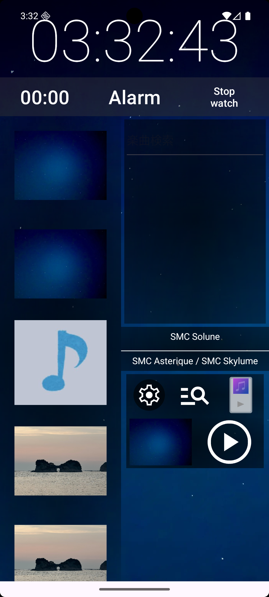
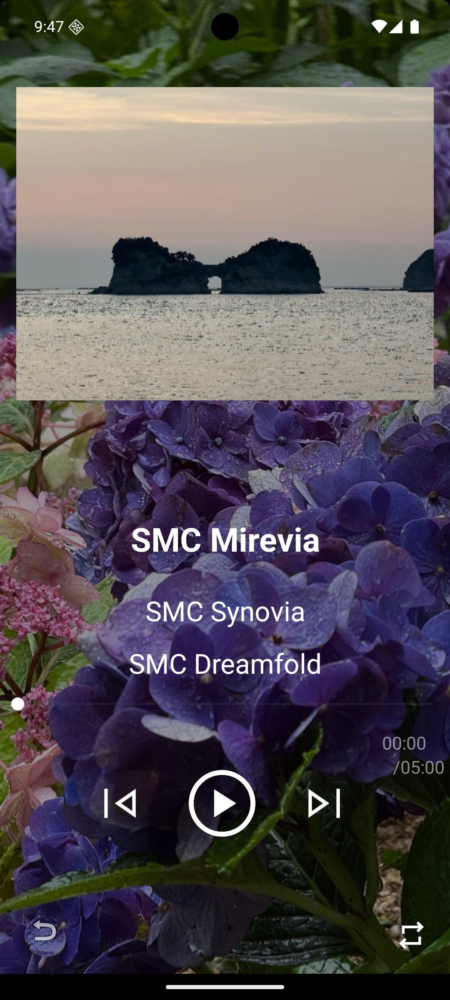
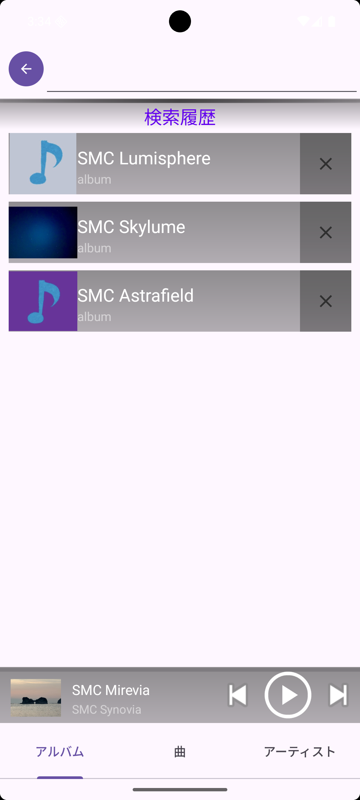
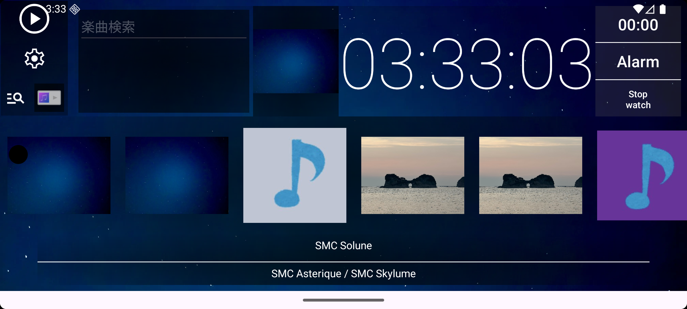
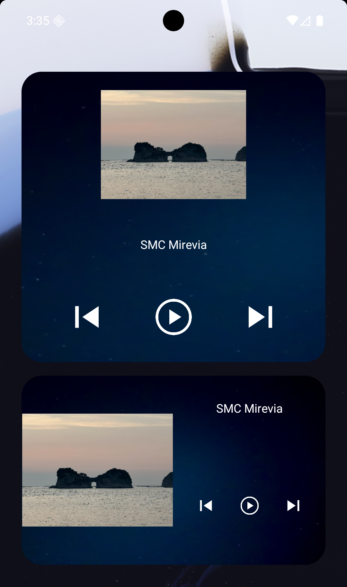

# Sense Music Clock

Sense Music Clock は、時計・タイマー・アラーム・ストップウォッチとローカル音楽プレイヤーをひとつの画面で扱う Android アプリです。

端末内の音楽ファイルを読み込み、アルバムアート付きのリスト、検索、プレイリスト、ブロックリスト、背景画像の切り替え、ホーム画面ウィジェットからの再生操作に対応しています。

## Screenshots

  
  
  

  
  

## Features

- 時計、タイマー、アラーム、ストップウォッチをメイン画面に表示
- Media3 ベースのローカル音楽再生
- アルバムアート付きの楽曲一覧表示
- 楽曲、アルバム、アーティストの検索・検索履歴
- プレイリストとブロックリストの管理
- 最近追加された曲の再生モード
- シャッフル、一曲ループ、音量調整、スリープタイマー
- 背景画像の追加、選択、ランダム表示
- ホーム画面ウィジェットからの再生、停止、前後スキップ
- 縦画面・横画面のプレイヤー UI

## 楽曲読み込みのキャンセル

`LocalMusicRepository` の読み込み・一覧更新関数は、省略可能な `cancellationSignal: CancellationSignal?` を受け取ります。`tracksFlow` を更新する関数を呼ぶと、Repositoryが保持している前の更新要求をキャンセルし、最新の要求だけが曲一覧とIDマップを更新します。キャンセルされた読み込みの途中結果は反映しません。

引数を省略した場合は、更新要求ごとにRepositoryが新しいシグナルを作成します。明示的に渡す場合も、要求ごとに新しい `CancellationSignal` を使ってください。一度キャンセルしたシグナルは再利用できません。`loadAlbumMusic` など一覧を返すだけの関数は、渡されたシグナルを使いますが、他の更新要求をキャンセルしません。

キャンセルによる一覧切り替えの回帰テストは `LocalMusicRepositoryCancellationTest` にあります。実機またはエミュレーター接続時に `./gradlew :app:connectedDebugAndroidTest -Pandroid.testInstrumentationRunnerArguments.class=jp.gr.java_conf.SenseMusicClock.LocalMusicRepositoryCancellationTest` で実行できます。

## 再生リスト更新と画面の再取得

`MusicService` は `setSafeMediaItems` の実行中・実行待ちにはページ取得を待機させ、更新を優先します。`onGetChildren` が返すのは、プレイヤーへの反映が完了した一覧です。

`MainActivity` は更新開始通知で取得中の一覧を破棄し、更新完了通知を受けて先頭ページから再取得します。900曲ごとの追加では再取得しません。ページの世代が途中で変わった場合も先頭から取り直し、更新前後の一覧の混在を防ぎます。更新に失敗した場合は待機表示を終了し、失敗をログに記録します。

優先順序とキャンセル・例外時のロック解放は、`./gradlew :app:testDebugUnitTest --tests jp.gr.java_conf.SenseMusicClock.Music.MediaItemsAccessTest` で確認できます。

## License

MIT License. See [LICENSE](LICENSE).
